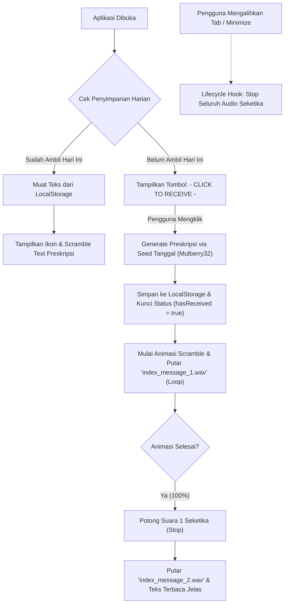

# The Index - Prescript Device

Dokumentasi arsitektur dan cara kerja aplikasi **Prescript Device** yang terinspirasi dari faksi *The Index* (*Limbus Company* / Project Moon).

Dokumentasi ini ditulis dalam **TypeScript** untuk menjelaskan seluruh struktur data, logika deterministik harian, mekanisme *scramble animation*, dan sinkronisasi audio.

---

```typescript
/**
 * ============================================================================
 * 1. STRUKTUR DATA & TIPE
 * ============================================================================
 */

export interface PrescriptDictionary {
  actions: readonly string[];
  targets: readonly string[];
  conditions: readonly string[];
}

export interface PrescriptDailyState {
  currentDate: string;        // Format: YYYY-MM-DD
  prescriptText: string;      // Teks preskripsi yang dihasilkan
  hasReceived: boolean;       // Status penguncian harian (1 kali per hari)
  isLoading: boolean;         // Indikator sinkronisasi penyimpanan lokal
}

export type ScramblePhase = 'CIPHER_SCRAMBLE' | 'DECODING_SWEEP' | 'RESOLVED';

export interface ScrambleTextState {
  progress: number;           // Nilai animasi 0.0 - 1.0
  resolvedCount: number;      // Jumlah karakter yang sudah terbuka
  frontierChars: string;      // 1-2 karakter di ujung decoding (efek pendar terang)
  unresolvedChars: string;    // Karakter acak yang belum terurai
}

/**
 * ============================================================================
 * 2. DETERMINISTIC GENERATION ENGINE (PRNG & HASHING)
 * ============================================================================
 * Logika ini menjamin seluruh perangkat mendapatkan kalimat preskripsi yang
 * persis sama di tanggal yang sama tanpa memerlukan koneksi backend/server.
 */
export class PrescriptGenerator {
  public static readonly actions: readonly string[] = [
    "Laksanakan",
    "Eksekusi",
    "Selesaikan",
    "Konsumsi",
    "Tonton dan cerna",
    "Push",
    "Pelajari",
    "Rapihkan",
    "Tinggalkan sejenak"
  ];

  public static readonly targets: readonly string[] = [
    "minimal 1 commit kode ke repositori GitHub",
    "satu porsi sayuran hijau",
    "ibadah wajibmu",
    "satu video pembelajaran pengembangan perangkat lunak",
    "dokumentasi framework atau bahasa pemrograman baru",
    "gelas berisi air putih penuh",
    "meja komputermu dari barang yang tidak perlu",
    "satu struktur database atau UI yang sedang kamu rancang",
    "bacaan literatur atau satu chapter ceritamu"
  ];

  public static readonly conditions: readonly string[] = [
    "sebelum kamu membuka aplikasi game apa pun hari ini.",
    "tanpa menyentuh layar handphone selama prosesnya berlangsung.",
    "sambil mempertahankan postur punggung yang lurus tegak.",
    "sebelum matahari terbenam.",
    "dengan keheningan total, tanpa mendengarkan musik.",
    "sebelum kamu membuka kembali tab browser yang tidak penting.",
    "sebagai bentuk kedisiplinan absolut.",
    "segera setelah kamu membaca pesan ini."
  ];

  /**
   * 32-bit FNV-1a Hash Algorithm
   * Mengubah string tanggal "YYYY-MM-DD" menjadi integer seed 32-bit yang unik.
   */
  public static hashSeed(dateString: string): number {
    let hash = 2166136261 >>> 0;
    for (let i = 0; i < dateString.length; i++) {
      hash ^= dateString.charCodeAt(i);
      hash = Math.imul(hash, 16777619) >>> 0;
    }
    return hash;
  }

  /**
   * Mulberry32 Pseudo-Random Number Generator (PRNG)
   * Menghasilkan bilangan acak deterministik bernilai [0, 1) dari integer seed.
   */
  public static createMulberry32(seed: number): () => number {
    let s = seed >>> 0;
    return function (): number {
      s = (s + 0x6D2B79F5) >>> 0;
      let t = s;
      t = Math.imul(t ^ (t >>> 15), t | 1);
      t ^= t + Math.imul(t ^ (t >>> 7), (t | 61) >>> 0);
      return ((t ^ (t >>> 14)) >>> 0) / 4294967296;
    };
  }

  /**
   * Menghasilkan preskripsi harian berdasarkan seed tanggal lokal.
   */
  public static generate(dateSeed: string): string {
    const seed = this.hashSeed(dateSeed);
    const random = this.createMulberry32(seed);

    const actionIdx = Math.floor(random() * this.actions.length);
    const targetIdx = Math.floor(random() * this.targets.length);
    const conditionIdx = Math.floor(random() * this.conditions.length);

    return `${this.actions[actionIdx]} ${this.targets[targetIdx]} ${this.conditions[conditionIdx]}`;
  }
}

/**
 * ============================================================================
 * 3. DAILY USE CONTROLLER (PENYIMPANAN & PENGUNCIAN HARIAN)
 * ============================================================================
 * Mengatur alur pemuatan lokal dan memastikan tombol hanya bisa ditekan
 * 1 kali per hari.
 */
export class IndexDeviceController {
  private static readonly KEY_DATE = "DAILY_PRESCRIPT_DEVICE_DATE";
  private static readonly KEY_TEXT = "DAILY_PRESCRIPT_DEVICE_TEXT";

  public state: PrescriptDailyState = {
    currentDate: this.getLocalDateString(),
    prescriptText: "",
    hasReceived: false,
    isLoading: true,
  };

  /**
   * Format tanggal lokal menjadi string YYYY-MM-DD.
   */
  public getLocalDateString(): string {
    const now = new Date();
    const year = now.getFullYear().toString().padStart(4, '0');
    const month = (now.getMonth() + 1).toString().padStart(2, '0');
    const day = now.getDate().toString().padStart(2, '0');
    return `${year}-${month}-${day}`;
  }

  /**
   * Inisialisasi awal saat aplikasi dibuka:
   * Memeriksa apakah preskripsi untuk hari ini sudah pernah diambil.
   */
  public async initDailyState(): Promise<void> {
    const today = this.getLocalDateString();
    this.state.currentDate = today;

    // Ambil riwayat dari LocalStorage / SharedPreferences
    const savedDate = localStorage.getItem(IndexDeviceController.KEY_DATE);
    const savedText = localStorage.getItem(IndexDeviceController.KEY_TEXT);

    if (savedDate === today && savedText) {
      // Kasus A: Sudah menerima preskripsi hari ini
      // Tombol disembunyikan, teks langsung dimunculkan
      this.state.prescriptText = savedText;
      this.state.hasReceived = true;
    } else {
      // Kasus B: Hari baru / belum menerima
      // Tombol "- CLICK TO RECEIVE -" ditampilkan
      this.state.prescriptText = "";
      this.state.hasReceived = false;
    }

    this.state.isLoading = false;
  }

  /**
   * Dijalankan saat pengguna menekan tombol "- CLICK TO RECEIVE -":
   * Men-generate preskripsi hari ini dan mengunci status secara permanen untuk hari ini.
   */
  public async receive(): Promise<string | null> {
    if (this.state.hasReceived) {
      return null; // Penguncian harian aktif: tidak dapat mengambil 2 kali
    }

    const today = this.state.currentDate || this.getLocalDateString();
    const generatedPrescript = PrescriptGenerator.generate(today);

    this.state.prescriptText = generatedPrescript;
    this.state.hasReceived = true;

    // Simpan ke penyimpanan persisten
    localStorage.setItem(IndexDeviceController.KEY_DATE, today);
    localStorage.setItem(IndexDeviceController.KEY_TEXT, generatedPrescript);

    return generatedPrescript;
  }

  /**
   * Reset testing shortcut (dipicu oleh double-tap icon).
   */
  public async resetForTesting(): Promise<void> {
    localStorage.removeItem(IndexDeviceController.KEY_DATE);
    localStorage.removeItem(IndexDeviceController.KEY_TEXT);
    this.state.prescriptText = "";
    this.state.hasReceived = false;
  }
}

/**
 * ============================================================================
 * 4. SCRAMBLE TEXT & DECODING ALGORITHM
 * ============================================================================
 * Mengatur pemunculan karakter teks dengan animasi dekode retro terminal.
 */
export class ScrambleTextEngine {
  private static readonly CHARSET = "ABCDEFGHIJKLMNOPQRSTUVWXYZ0123456789!@#$%^&*()_+-=[]{}|;:,.<>?/~";

  /**
   * Menghitung status karakter pada setiap tick animasi.
   * Karakter spasi (' ') selalu dipertahankan agar tata letak (word-wrap) tidak bergeser.
   */
  public static calculateFrame(
    fullText: string,
    progress: number // Nilai 0.0 sampai 1.0 dari AnimationController
  ): ScrambleTextState {
    const len = fullText.length;

    // Fase 1: 0.00 - 0.10 -> Seluruh karakter scrambling penuh
    // Fase 2: 0.10 - 0.94 -> Dekode menyapu progresif dari kiri ke kanan
    // Fase 3: 0.94 - 1.00 -> Teks terkunci sempurna
    const sweepProgress = Math.max(0, Math.min(1, (progress - 0.10) / 0.84));
    const resolvedCount = Math.floor(sweepProgress * len);

    return {
      progress,
      resolvedCount,
      frontierChars: fullText.slice(resolvedCount, Math.min(len, resolvedCount + 2)),
      unresolvedChars: fullText.slice(Math.min(len, resolvedCount + 2)),
    };
  }

  public static getRandomGlyph(): string {
    const idx = Math.floor(Math.random() * this.CHARSET.length);
    return this.CHARSET[idx];
  }
}

/**
 * ============================================================================
 * 5. AUDIO & LIFECYCLE COORDINATION
 * ============================================================================
 * Sinkronisasi pemutaran suara pesan 1 (mengetik/transmisi) dan pesan 2 (selesai),
 * serta penanganan otomatis saat aplikasi beralih tab / minimize.
 */
export class PrescriptAudioManager {
  private isScramblingPlaying: boolean = false;

  /**
   * Dipanggil saat animasi teks scramble mulai berjalan:
   * Memutar file 'index_message_1.wav' dalam mode loop.
   */
  public onAnimationStart(): void {
    this.isScramblingPlaying = true;
    // audioPlayer1.setReleaseMode(Loop);
    // audioPlayer1.play('index_message_1.wav');
  }

  /**
   * Dipanggil begitu animasi scramble selesai (100%):
   * Memotong seketika suara pesan 1 dan langsung membunyikan pesan 2.
   */
  public onAnimationComplete(): void {
    if (this.isScramblingPlaying) {
      this.isScramblingPlaying = false;
      // audioPlayer1.stop(); // Dipotong seketika tanpa sisa
    }
    // audioPlayer2.play('index_message_2.wav'); // Suara lonceng/stempel konfirmasi
  }

  /**
   * Dipanggil saat tab browser beralih, aplikasi di-minimize, atau kehilangan fokus:
   * Menghentikan seluruh audio agar tidak berjalan di latar belakang.
   */
  public onAppLifecycleChange(state: 'resumed' | 'inactive' | 'paused' | 'hidden'): void {
    if (state === 'inactive' || state === 'paused' || state === 'hidden') {
      this.isScramblingPlaying = false;
      // audioPlayer1.stop();
      // audioPlayer2.stop();
    }
  }
}
```

---

### Ringkasan Alur Kerja Utama


